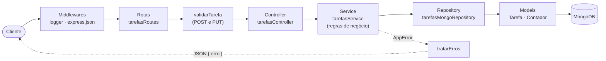

# TaskFlow API

API REST do **TaskFlow**, um gerenciador de tarefas inspirado no Jira, desenvolvida em **Node.js, Express e MongoDB** como projeto final do **Módulo 5** do curso do Senac.

Este repositório contém o **backend**. O frontend, feito em Vue.js no Módulo 4, fica em um repositório separado:

- 🖥️ **Frontend:** [github.com/philoDu/ProjetoFinal_Modulo4](https://github.com/philoDu/ProjetoFinal_Modulo4) · [aplicação publicada](https://philodu.github.io/ProjetoFinal_Modulo4/)

> **Para avaliar o projeto:** este repositório não usa os scripts `.bat` do template da disciplina. Siga [Como executar](#como-executar) para subir a aplicação e depois o [Roteiro de validação](#roteiro-de-validação), que confere cada entrega em poucos minutos.

## Sumário

- [Tecnologias](#tecnologias)
- [Como executar](#como-executar)
- [Roteiro de validação](#roteiro-de-validação)
- [Diferenças em relação ao template do professor](#diferenças-em-relação-ao-template-do-professor)
- [Variáveis de ambiente](#variáveis-de-ambiente)
- [Referência da API](#referência-da-api)
- [Modelo da tarefa](#modelo-da-tarefa)
- [Arquitetura](#arquitetura)
- [Visualizando os dados no MongoDB](#visualizando-os-dados-no-mongodb)
- [Solução de problemas](#solução-de-problemas)
- [Registro de entregas](#registro-de-entregas)
- [Próximos passos](#próximos-passos)
- [Autor](#autor)

---

## Tecnologias

- **[Node.js](https://nodejs.org/)** 26 (LTS), com ES Modules: ambiente de execução
- **[Express 5](https://expressjs.com/)**: framework web das rotas
- **[MongoDB 8](https://www.mongodb.com/)**: banco de dados de documentos
- **[Mongoose 9](https://mongoosejs.com/)**: conexão e modelagem dos dados
- **[dotenv](https://github.com/motdotla/dotenv)**: configuração por variáveis de ambiente
- **[Docker](https://www.docker.com/) e Docker Compose**: ambiente em containers

Desenvolvido em **Ubuntu no WSL 2**, com Docker Desktop integrado ao WSL.

## Como executar

### Pré-requisitos

- **[Docker Desktop](https://www.docker.com/products/docker-desktop/)** (Windows ou macOS) ou **Docker Engine com o plugin Compose** (Linux). O Docker precisa estar **aberto e em execução**.
- **[Git](https://git-scm.com/)**, para clonar o repositório (ou baixe o ZIP pelo botão *Code → Download ZIP* do GitHub).

Não é preciso instalar Node.js nem MongoDB: os dois rodam dentro dos containers.

### Passo a passo

**1. Clonar o repositório**

```sh
git clone https://github.com/philoDu/ProjetoFinal_Modulo5.git
cd ProjetoFinal_Modulo5
```

**2. Criar o arquivo `.env` a partir do modelo**

| Sistema | Comando |
|---|---|
| Linux, macOS, WSL, Git Bash, PowerShell | `cp .env.example .env` |
| Prompt de Comando (cmd) do Windows | `copy .env.example .env` |

Os valores do modelo já funcionam; não é preciso editar nada. O `.env` não é versionado (está no `.gitignore`), por isso precisa ser criado em cada máquina. Sem ele, o Compose recusa a subida com a mensagem `env file ... .env not found`.

**3. Construir e subir a API e o banco**

```sh
docker compose up --build -d
```

Na primeira vez, o Docker baixa as imagens do Node e do MongoDB, o que pode levar alguns minutos. O Compose espera o MongoDB ficar pronto (*healthy*) antes de iniciar a API.

**4. Acessar**

- Página inicial: <http://localhost:3000>
- Diagnóstico: <http://localhost:3000/health>, que deve mostrar `"mongo": "conectado"`
- Tarefas: <http://localhost:3000/tarefas>

Para conferir os containers e acompanhar os logs:

```sh
docker compose ps            # os dois serviços devem aparecer como "running"
docker compose logs -f api   # logs da API (Ctrl+C para sair dos logs)
```

**5. Parar**

```sh
docker compose down          # para e remove os containers; os dados são preservados
docker compose down -v       # idem, e APAGA o volume com os dados do banco
```

Os dados ficam em um volume nomeado do Docker (`mongo-data`) e continuam lá na próxima vez que o projeto subir, a menos que se use `-v`.

> **Recarregamento automático:** no Compose, a API roda com `npm run dev` (`node --watch`) e a pasta `src/` é montada dentro do container. Uma alteração no código reinicia a API sem reconstruir a imagem. Só é preciso usar `--build` de novo quando o `package.json` mudar.

### Executando a API fora do Docker

Útil para depurar a API direto na máquina. Nesse modo, só o banco roda no container.

Pré-requisito adicional: **Node.js 20.19 ou superior** (exigência do Mongoose 9; a versão LTS atual atende).

```sh
# Subir apenas o MongoDB
docker compose up -d mongo

# Instalar as dependências e iniciar a API com recarregamento automático
npm install
npm run dev
```

A API lê o `.env`, cujo `MONGODB_URI` aponta para `localhost:27017`, a porta que o container do MongoDB publica na máquina. Para encerrar, use `Ctrl+C` no terminal da API e `docker compose down` para o banco.

Não rode os dois modos ao mesmo tempo: o container `api` e o `npm run dev` disputariam a porta 3000.

| Script | Descrição |
|---|---|
| `npm run dev` | Inicia a API e a reinicia a cada alteração em `src/` |
| `npm start` | Inicia a API sem recarregamento (usado pela imagem Docker) |

## Roteiro de validação

Com a aplicação rodando ([Como executar](#como-executar)), estes passos conferem cada entrega. Os comandos usam `curl`, que funciona em Linux, macOS, WSL e Git Bash. No Windows PowerShell, use os [equivalentes com `Invoke-RestMethod`](#no-windows-powershell). Tudo também pode ser feito no Insomnia ([como reproduzir](#no-insomnia-ou-ferramentas-equivalentes)).

### Entrega 1: ambiente com Docker, página inicial e `/health`

1. `docker compose ps` mostra **dois** containers em execução: `taskflow-api` e `taskflow-mongo` (este como `healthy`).
2. <http://localhost:3000> abre a página inicial do TaskFlow. Na entrega 1 ela mostrava "API do Felipe"; a entrega 3 pediu a troca pelo texto atual (veja o passo 7 da entrega 3).
3. <http://localhost:3000/health> responde com `"ok": true` e `"mongo": "conectado"`.

### Entrega 2: `express.Router`, middlewares de validação e testes das rotas

1. O middleware de validação recusa uma tarefa sem título, com `400` e `{"erro":"O título é obrigatório."}`:

   ```sh
   curl -i -X POST http://localhost:3000/tarefas -H "Content-Type: application/json" -d '{"tipo":"bug"}'
   ```

2. O middleware de erros responde em JSON a um corpo mal formatado (`400`) e o de rota não encontrada, a um caminho inexistente (`404`):

   ```sh
   curl -i -X POST http://localhost:3000/tarefas -H "Content-Type: application/json" -d '{"titulo":"x",}'
   curl -i http://localhost:3000/rota-que-nao-existe
   ```

3. Cada requisição aparece no log da API, registrada pelo middleware `logger`: `docker compose logs api`.

As rotas ficam em [`src/routes/tarefasRoutes.js`](src/routes/tarefasRoutes.js) e os middlewares em [`src/middlewares/`](src/middlewares/).

### Entrega 3: CRUD completo no MongoDB

1. **Criar:** anote o `id` devolvido (resposta `201`).

   ```sh
   curl -i -X POST http://localhost:3000/tarefas -H "Content-Type: application/json" -d '{"titulo":"Tarefa de teste","prioridade":"alta"}'
   ```

2. **Listar** e **buscar** (troque `ID` pelo `id` anotado):

   ```sh
   curl http://localhost:3000/tarefas
   curl http://localhost:3000/tarefas/ID
   ```

3. **Conferir no banco:** no MongoDB Compass, conecte em `mongodb://localhost:27017` e abra `taskflow` → `tarefas`. A tarefa criada aparece lá ([passo a passo](#visualizando-os-dados-no-mongodb)).
4. **Atualizar:** a resposta `200` traz `"status": "concluida"` e `concluidaEm` preenchido.

   ```sh
   curl -X PATCH http://localhost:3000/tarefas/ID -H "Content-Type: application/json" -d '{"status":"concluida"}'
   ```

5. **Persistência:** os dados sobrevivem ao reinício dos containers.

   ```sh
   docker compose down
   docker compose up -d
   curl http://localhost:3000/tarefas/ID
   ```

6. **Excluir:** a resposta é `204`, e buscar a tarefa de novo dá `404`.

   ```sh
   curl -i -X DELETE http://localhost:3000/tarefas/ID
   curl -i http://localhost:3000/tarefas/ID
   ```

7. **Página inicial:** <http://localhost:3000> mostra o texto "API Gerenciador de Tarefas".

Outros casos de erro (pontos com mais de duas casas, data de entrega anterior à de início, chamado concluído sem solução, `id` inválido) estão nos [exemplos de `curl`](#exemplos-com-curl).

## Diferenças em relação ao template do professor

O template da disciplina ([philoDu/modulo5-backend](https://github.com/philoDu/modulo5-backend)) foi usado como guia, mas este projeto foi montado do zero com outra organização. Por isso os passos para rodar são diferentes.

| No template | Neste projeto |
|---|---|
| Copiar o arquivo `env` para `.env` | `cp .env.example .env` |
| `run.bat` | `docker compose up --build -d` |
| `stop.bat` | `docker compose down` |
| Código em `app/src/index.js` | Código em `src/`, separado em camadas ([arquitetura](#arquitetura)) |
| Banco `curso` | Banco `taskflow` |

As principais diferenças no ambiente:

- **Dois containers em vez de um:** a API, construída pelo [`Dockerfile`](Dockerfile) do projeto, e o MongoDB, com a imagem oficial `mongo:8`. Cada serviço pode ser reiniciado sozinho, e a separação reproduz a futura publicação, em que o banco ficará no MongoDB Atlas.
- **Sem passos manuais depois de subir:** as dependências são instaladas na construção da imagem, e os dados do banco ficam em um volume do Docker, sem ajuste de permissões.
- **Comandos do Docker Compose em vez de `.bat`:** funcionam igualmente em Windows, macOS e Linux. O projeto foi desenvolvido em Linux (WSL 2).
- **A API espera o banco:** o Compose só inicia a API depois que o MongoDB responde, e a API tenta reconectar se o banco cair.

## Variáveis de ambiente

Definidas no arquivo `.env`, criado a partir do [`.env.example`](.env.example). O `.env.example` não contém segredos.

| Variável | Descrição | Valor no `.env.example` |
|---|---|---|
| `PORT` | Porta em que a API escuta | `3000` |
| `MONGODB_URI` | Endereço de conexão com o MongoDB, incluindo o nome do banco | `mongodb://localhost:27017/taskflow` |
| `NODE_ENV` | Ambiente de execução. Com `production`, a API desiste da conexão após 5 tentativas; com qualquer outro valor, tenta indefinidamente. Aparece no `/health` como `ambiente`. | `development` |

Observações:

- No Docker Compose, o `MONGODB_URI` é **substituído** por `mongodb://mongo:27017/taskflow`, porque dentro da rede do Compose o banco é encontrado pelo nome do serviço (`mongo`), não por `localhost`. Veja [`localhost` dentro e fora do container](#localhost-dentro-e-fora-do-container).
- No Docker, mantenha `PORT=3000`: o mapeamento de portas do `docker-compose.yml` é fixo em `3000:3000`. Para usar outra porta na máquina, altere só o lado esquerdo do mapeamento (por exemplo `"3001:3000"`).

## Referência da API

URL base: `http://localhost:3000`. Os corpos de requisição e de resposta são JSON (`Content-Type: application/json`).

### Resumo das rotas

| Método | Rota | Descrição | Sucesso |
|---|---|---|---|
| `GET` | `/` | Página inicial (HTML) | `200` |
| `GET` | `/health` | Diagnóstico da API e do banco | `200` (ou `503` sem banco) |
| `GET` | `/tarefas` | Lista todas as tarefas, das mais novas para as mais antigas | `200` |
| `POST` | `/tarefas` | Cria uma tarefa | `201` |
| `GET` | `/tarefas/:id` | Busca uma tarefa pelo `id` | `200` |
| `PATCH` | `/tarefas/:id` | Atualiza só os campos enviados; os demais são mantidos | `200` |
| `PUT` | `/tarefas/:id` | Substitui a tarefa: exige o `titulo`, e os campos não enviados voltam ao valor padrão | `200` |
| `DELETE` | `/tarefas/:id` | Exclui uma tarefa | `204` |

### Códigos HTTP

| Código | Quando acontece |
|---|---|
| `200 OK` | Leitura ou atualização bem-sucedida |
| `201 Created` | Tarefa criada |
| `204 No Content` | Tarefa excluída (resposta sem corpo) |
| `400 Bad Request` | Dados inválidos, regra de negócio violada ou JSON mal formatado |
| `404 Not Found` | Tarefa inexistente, `id` em formato inválido ou rota inexistente |
| `500 Internal Server Error` | Erro inesperado (detalhes no log da API) ou banco indisponível |
| `503 Service Unavailable` | Só no `/health`: a API está no ar, mas sem conexão com o MongoDB |

### Formato dos erros

Todo erro devolve um objeto com a chave `erro`:

```json
{ "erro": "Tarefa não encontrada." }
```

Quando o Mongoose rejeita o tipo de um campo (por exemplo, um objeto onde se espera texto), a resposta também lista os campos com problema:

```json
{ "erro": "Dados inválidos.", "campos": ["descricao"] }
```

### `GET /`

Página HTML de apresentação, com o texto "API Gerenciador de Tarefas" e um link para o `/health`.

### `GET /health`

```json
{
  "ok": true,
  "node": "v26.13.1",
  "uptime": 12.84,
  "mongo": "conectado",
  "ambiente": "development"
}
```

`mongo` pode ser `conectado`, `conectando`, `desconectando` ou `desconectado`. Quando não está `conectado`, a resposta tem código `503` e `"ok": false`; a API continua no ar, por isso o `/health` é o primeiro lugar para diagnosticar problemas. O código `503` também permite que a plataforma de hospedagem perceba a falha. `uptime` é o tempo, em segundos, desde que a API iniciou.

### `POST /tarefas`

Só o `titulo` é obrigatório; os demais campos recebem os [valores padrão](#modelo-da-tarefa).

Corpo:

```json
{
  "titulo": "Corrigir login",
  "tipo": "bug",
  "prioridade": "alta",
  "dataInicio": "2026-11-20",
  "dataEntrega": "2026-11-30",
  "pontos": 2.5,
  "responsaveis": ["felipe"]
}
```

Resposta `201`:

```json
{
  "id": "6b0305f8097e0aa7e87250db",
  "codigo": "TF-1",
  "tipo": "bug",
  "titulo": "Corrigir login",
  "descricao": "",
  "projeto": null,
  "status": "a-fazer",
  "prioridade": "alta",
  "responsaveis": ["felipe"],
  "dataInicio": "2026-11-20",
  "dataEntrega": "2026-11-30",
  "pontos": 2.5,
  "vinculadas": [],
  "solucao": "",
  "concluidaEm": null,
  "criadoEm": "2026-11-22T15:10:48.812Z",
  "atualizadoEm": "2026-11-22T15:10:48.812Z"
}
```

Campos fora da lista de [campos editáveis](#modelo-da-tarefa), como `id`, `codigo`, `concluidaEm` e `criadoEm`, são ignorados se forem enviados.

Erros possíveis (`400`):

| Situação | Mensagem |
|---|---|
| `titulo` ausente ou vazio | `O título é obrigatório.` |
| `titulo` com mais de 120 caracteres | `O título deve ter no máximo 120 caracteres.` |
| `tipo`, `status` ou `prioridade` fora da lista | `Tipo inválido. Use: tarefa, bug, chamado.` (e equivalentes) |
| Data inexistente ou fora do formato `AAAA-MM-DD` | `O campo 'dataEntrega' deve ser uma data válida no formato AAAA-MM-DD.` |
| `dataEntrega` anterior à `dataInicio` (RN05) | `A data de entrega não pode ser anterior à data de início.` |
| `pontos` negativo ou com mais de duas casas (RN12) | `Os pontos devem ser um número não negativo, com até duas casas decimais.` |
| `responsaveis` ou `vinculadas` que não são lista | `O campo 'responsaveis' deve ser uma lista.` |
| `vinculadas` com itens que não são texto | `O campo 'vinculadas' deve conter apenas ids de tarefas.` |
| `vinculadas` com ids de tarefas que não existem | `Tarefas vinculadas não encontradas: <ids>.` |
| Chamado criado ou atualizado como `concluida` sem `solucao` (RN14) | `Um chamado só pode ser concluído com a solução preenchida.` |
| Campo com tipo incompatível | `Dados inválidos.` com a lista `campos` |
| JSON mal formatado | `O corpo da requisição não é um JSON válido.` |

### `GET /tarefas`

Resposta `200`: uma lista de tarefas no mesmo formato da criação (`[]` se não houver nenhuma).

### `GET /tarefas/:id`

Resposta `200`: a tarefa. Resposta `404` com `{ "erro": "Tarefa não encontrada." }` se o `id` não existir ou não tiver o formato de um ObjectId do MongoDB (24 caracteres hexadecimais).

### `PATCH /tarefas/:id`

Atualização parcial: envie apenas os campos que devem mudar; os outros são mantidos.

Corpo:

```json
{ "status": "concluida" }
```

Resposta `200`: a tarefa atualizada. Ao passar para `concluida`, `concluidaEm` recebe a data e a hora atuais; ao sair de `concluida`, volta a `null` (RN15).

### `PUT /tarefas/:id`

Substituição: o corpo representa a tarefa inteira. O `titulo` é obrigatório, e todo campo editável que não for enviado volta ao [valor padrão](#modelo-da-tarefa); a `dataEntrega` padrão é a data de criação da tarefa mais 30 dias. O `id`, o `codigo` e o `criadoEm` são preservados.

Corpo:

```json
{
  "titulo": "Corrigir login",
  "tipo": "bug",
  "status": "em-andamento",
  "prioridade": "alta",
  "dataEntrega": "2026-12-15"
}
```

Resposta `200`: a tarefa substituída. Neste exemplo, `descricao`, `pontos`, `responsaveis`, `vinculadas` e os demais campos não enviados voltam aos valores padrão.

### Erros do `PATCH` e do `PUT`

`400` para as mesmas validações da criação e para uma tarefa vinculada a ela mesma (RN10: `Uma tarefa não pode ser vinculada a si mesma.`); `404` se a tarefa não existir.

### `DELETE /tarefas/:id`

Resposta `204`, sem corpo. O `id` excluído também é removido da lista `vinculadas` das outras tarefas (RN11). Resposta `404` se a tarefa não existir.

### Exemplos com `curl`

Os exemplos abaixo funcionam em **Linux, macOS, WSL e Git Bash**. Para o Windows PowerShell, veja a seção seguinte.

```sh
# Página inicial e diagnóstico
curl http://localhost:3000/
curl http://localhost:3000/health

# Criar uma tarefa
curl -X POST http://localhost:3000/tarefas \
  -H "Content-Type: application/json" \
  -d '{"titulo":"Corrigir login","tipo":"bug","prioridade":"alta","pontos":2.5}'

# Listar
curl http://localhost:3000/tarefas

# Buscar, atualizar e excluir (troque ID pelo "id" devolvido na criação)
curl http://localhost:3000/tarefas/ID
curl -X PATCH http://localhost:3000/tarefas/ID \
  -H "Content-Type: application/json" \
  -d '{"status":"concluida"}'
curl -X DELETE -i http://localhost:3000/tarefas/ID
```

Casos de erro:

```sh
# 400: título ausente
curl -X POST http://localhost:3000/tarefas -H "Content-Type: application/json" -d '{"tipo":"bug"}'

# 400: pontos com mais de duas casas decimais
curl -X POST http://localhost:3000/tarefas -H "Content-Type: application/json" -d '{"titulo":"x","pontos":1.234}'

# 400: data de entrega anterior à data de início
curl -X POST http://localhost:3000/tarefas -H "Content-Type: application/json" -d '{"titulo":"x","dataInicio":"2026-12-10","dataEntrega":"2026-12-01"}'

# 400: chamado concluído sem solução
curl -X POST http://localhost:3000/tarefas -H "Content-Type: application/json" -d '{"titulo":"x","tipo":"chamado","status":"concluida"}'

# 400: JSON mal formatado (vírgula sobrando)
curl -X POST http://localhost:3000/tarefas -H "Content-Type: application/json" -d '{"titulo":"x",}'

# 404: id inexistente e id em formato inválido
curl http://localhost:3000/tarefas/000000000000000000000000
curl http://localhost:3000/tarefas/abc
```

Para ver o código HTTP junto com a resposta, acrescente `-i` a qualquer comando.

#### No Windows PowerShell

No Windows PowerShell, `curl` é um apelido de outro comando (`Invoke-WebRequest`) e as aspas do JSON são tratadas de outro jeito. Use o `Invoke-RestMethod`, que já converte a resposta:

```powershell
# Listar
Invoke-RestMethod http://localhost:3000/tarefas

# Criar (o UTF8.GetBytes preserva os acentos)
$corpo = '{"titulo":"Revisão do código","prioridade":"alta"}'
$tarefa = Invoke-RestMethod -Method Post -Uri http://localhost:3000/tarefas -ContentType "application/json" -Body ([Text.Encoding]::UTF8.GetBytes($corpo))
$tarefa

# Atualizar e excluir usando o id devolvido
Invoke-RestMethod -Method Patch -Uri "http://localhost:3000/tarefas/$($tarefa.id)" -ContentType "application/json" -Body '{"status":"concluida"}'
Invoke-RestMethod -Method Delete -Uri "http://localhost:3000/tarefas/$($tarefa.id)"
```

Outra opção é rodar os exemplos de `curl` no **Git Bash** ou no **WSL**.

#### No Insomnia ou ferramentas equivalentes

Todos os exemplos podem ser reproduzidos no [Insomnia](https://insomnia.rest/), no Postman, no Thunder Client (VS Code) ou em ferramentas equivalentes: crie uma requisição com o método e a URL, escolha o corpo **JSON** e cole o conteúdo do `-d`. O Insomnia também importa um comando `curl` colado no campo da URL.

## Modelo da tarefa

A referência completa das entidades e das regras de negócio (RN01 a RN15) está em [`docs/dominio.md`](docs/dominio.md). Lá também estão as entidades previstas para as próximas etapas (usuários, equipes e projetos) e as regras marcadas como futuras.

| Campo | Tipo | Padrão | Observações |
|---|---|---|---|
| `id` | texto (ObjectId) | gerado | Identificador usado nas rotas |
| `codigo` | texto | gerado | Sequencial e legível (`TF-1`, `TF-2`…); nunca é reutilizado, mesmo após exclusões (RN04) |
| `tipo` | texto | `tarefa` | `tarefa`, `bug` ou `chamado` |
| `titulo` | texto | (obrigatório) | Até 120 caracteres; espaços nas pontas são removidos |
| `descricao` | texto | `""` | |
| `projeto` | texto | `null` | Será obrigatório quando os projetos existirem (RN01) |
| `status` | texto | `a-fazer` | `a-fazer`, `em-andamento`, `em-revisao` ou `concluida` |
| `prioridade` | texto | `media` | `baixa`, `media`, `alta` ou `critica` |
| `responsaveis` | lista de textos | `[]` | Passará a guardar ids de usuários |
| `dataInicio` | data `AAAA-MM-DD` | `null` | |
| `dataEntrega` | data `AAAA-MM-DD` | criação + 30 dias, no horário de Brasília | Não pode ser anterior à `dataInicio` (RN03, RN05) |
| `pontos` | número | `null` | ≥ 0, até duas casas decimais; armazenado em centésimos (2,5 → `250`) e convertido na entrada e na saída (RN12, RN13) |
| `vinculadas` | lista de ids de tarefas | `[]` | Só ids de tarefas existentes, sem repetição; não pode conter o próprio `id` (RN10) |
| `solucao` | texto | `""` | Obrigatória para concluir um `chamado` (RN14) |
| `concluidaEm` | data e hora | `null` | Preenchido pelo sistema ao concluir e apagado ao reabrir (RN15) |
| `criadoEm`, `atualizadoEm` | data e hora | gerados | Mantidos pelo Mongoose |

Os campos que o cliente pode enviar são: `tipo`, `titulo`, `descricao`, `projeto`, `status`, `prioridade`, `responsaveis`, `dataInicio`, `dataEntrega`, `pontos`, `vinculadas` e `solucao`. Os demais são controlados pelo sistema.

## Arquitetura

O código segue uma arquitetura em camadas: cada camada conhece só a seguinte. Caminho de uma requisição, por exemplo `POST /tarefas`:



Em texto: `Cliente → logger → express.json → router /tarefas → validarTarefa → controller → service → repository → model (Mongoose) → MongoDB`. A resposta volta pelo mesmo caminho. Qualquer erro lançado no meio cai no middleware `tratarErros`, que o converte em JSON com o código HTTP adequado; uma rota que não existe cai no `rotaNaoEncontrada` (404).

| Pasta / arquivo | Papel |
|---|---|
| `src/server.js` | Ponto de entrada: conecta ao banco (com *top-level await*) e só então liga o servidor |
| `src/app.js` | Monta o Express: middlewares, página inicial, `/health`, rotas de `/tarefas`, 404 e tratamento de erros, nessa ordem |
| `src/config/` | `env.js` lê as variáveis de ambiente; `database.js` faz a conexão com novas tentativas e informa o estado do banco |
| `src/constants/` | Valores de domínio compartilhados: tipos, status e prioridades |
| `src/middlewares/` | `logger` (registra cada requisição), `validarTarefa` (exige o título na criação e na substituição), `rotaNaoEncontrada` (404) e `tratarErros` (erros em JSON) |
| `src/routes/` | `express.Router` com as rotas de `/tarefas` |
| `src/controllers/` | Traduz entre HTTP e o service: lê `params` e `body` e escolhe o código da resposta |
| `src/services/` | Regras de negócio (RN01 a RN15): valores padrão, validações, pontos em centésimos, conclusão |
| `src/repositories/` | Acesso aos dados. `tarefasMongoRepository.js` é o usado. `tarefasMemoryRepository.js` é a implementação em memória da entrega 2, mantida de propósito para testes futuros; os dois têm a mesma interface |
| `src/models/` | Schemas do Mongoose: `Tarefa` e `Contador` (gera o código sequencial `TF-n`) |
| `src/utils/` | `AppError`: erro com código HTTP, lançado pelo service |
| `src/pages/` | HTML da página inicial |
| `docs/dominio.md` | Documentação do domínio: entidades, relacionamentos e regras de negócio |

## Visualizando os dados no MongoDB

Com o projeto rodando, o MongoDB fica acessível na máquina pela porta `27017`. O banco se chama `taskflow` e tem duas coleções: `tarefas` e `contadores` (o último código `TF-n` gerado).

### MongoDB Compass

1. Instale o [MongoDB Compass](https://www.mongodb.com/products/tools/compass).
2. Clique em **Add new connection**, use a URI `mongodb://localhost:27017` e clique em **Connect**. Não há usuário nem senha.
3. Abra o banco **`taskflow`** e a coleção **`tarefas`**.

Os pontos aparecem em centésimos (`250` para 2,5 pontos), como define a RN13; a API faz a conversão.

### Pelo terminal, com `mongosh`

O `mongosh` já vem dentro do container do MongoDB, então não é preciso instalar nada:

```sh
docker compose exec mongo mongosh taskflow
```

Dentro do shell:

```js
db.tarefas.find()                                   // todas as tarefas
db.tarefas.find({ status: "concluida" })            // filtrar
db.tarefas.countDocuments()                         // quantidade
db.contadores.find()                                // último código gerado
exit
```

Ou um comando único, sem entrar no shell:

```sh
docker compose exec mongo mongosh taskflow --quiet --eval "db.tarefas.find().toArray()"
```

## Solução de problemas

O primeiro passo em qualquer problema é olhar o `/health` e os logs: `docker compose logs api` e `docker compose logs mongo`.

### Docker Desktop fechado

Mensagens como `Cannot connect to the Docker daemon`, `error during connect` ou `open //./pipe/dockerDesktopLinuxEngine: The system cannot find the file specified` indicam que o Docker não está em execução. Abra o Docker Desktop, espere ele mostrar que está rodando (*Engine running*) e repita o comando. No Linux, inicie o serviço com `sudo systemctl start docker`.

### `env file ... .env not found`

O `.env` não foi criado. Volte ao [passo 2](#passo-a-passo).

### Porta 3000 ou 27017 ocupada

O erro `Bind for 0.0.0.0:3000 failed: port is already allocated` (ou `ports are not available`) significa que outro programa já usa a porta. Exemplos comuns: outra API rodando com `npm run dev`, outro projeto em Docker ou um **MongoDB instalado localmente** (na 27017).

Para descobrir quem está usando a porta:

```sh
# Windows (PowerShell ou cmd)
netstat -ano | findstr :3000

# Linux / macOS
lsof -i :3000
```

Encerre o programa que ocupa a porta (`docker ps` lista os containers em execução) ou troque a porta da máquina no `docker-compose.yml`, alterando só o número da esquerda: `"3001:3000"` para a API ou `"127.0.0.1:27018:27017"` para o banco. Se trocar a do banco, conecte o Compass em `mongodb://localhost:27018`.

Atenção: com um MongoDB local instalado e ativo na 27017, o Compass pode se conectar a ele em vez de ao container, e as tarefas da API não aparecem. Pare o serviço local ou use outra porta.

### API sem conexão com o banco

Sintomas: o `/health` responde `503` com `"mongo": "desconectado"`, as rotas de `/tarefas` demoram cerca de 10 s e respondem `500`, ou o log mostra `[MONGO] Tentativa N falhou`.

- Confira se o banco está de pé: `docker compose ps` deve mostrar `taskflow-mongo` como `healthy`. Se não estiver, rode `docker compose up -d` e veja `docker compose logs mongo`.
- Em desenvolvimento, a API continua tentando sozinha a cada 3 s e conecta assim que o banco voltar; não é preciso reiniciá-la.
- Rodando fora do Docker, confira se o MongoDB foi iniciado (`docker compose up -d mongo`) e se o `MONGODB_URI` do `.env` usa `localhost`.

### `localhost` dentro e fora do container

Cada container tem a própria rede: dentro do container da API, `localhost` é o próprio container, não a sua máquina nem o container do banco.

| De onde parte a conexão | Endereço do MongoDB |
|---|---|
| API rodando no container (`docker compose up`) | `mongodb://mongo:27017/taskflow` (o nome do serviço no Compose) |
| API rodando na máquina (`npm run dev`) | `mongodb://localhost:27017/taskflow` |
| Compass ou `mongosh` instalados na máquina | `mongodb://localhost:27017` |

Por isso o `docker-compose.yml` substitui o `MONGODB_URI` do `.env` pelo endereço com `mongo`. Do navegador, a API é sempre acessada em `http://localhost:3000`, porque essa porta é publicada para a máquina.

### Acentos trocados por `�` ao criar tarefas pelo terminal do Windows

Alguns terminais do Windows não enviam o corpo em UTF-8. Use o exemplo com `Invoke-RestMethod` e `UTF8.GetBytes` da seção [No Windows PowerShell](#no-windows-powershell) ou envie o corpo a partir de um arquivo salvo em UTF-8: `curl ... --data-binary @tarefa.json`.

### Alterações no código não aparecem

Alterações em `src/` reiniciam a API sozinhas; confira em `docker compose logs -f api`. Se o recarregamento não acontecer (algumas montagens de pasta do Windows não avisam o container sobre arquivos alterados), rode `docker compose restart api`. Se mudou o `package.json`, reconstrua: `docker compose up --build -d`.

## Registro de entregas

| Entrega | Tema | Situação |
|---|---|---|
| 1 | Ambiente com Docker, página inicial e `/health` | ✅ Entregue |
| 2 | `express.Router` e middlewares de validação | ✅ Entregue |
| 3 | CRUD de tarefas com MongoDB | ✅ Concluída nesta versão |

### Entrega 1: ambiente com Docker, página inicial e `/health`

- Projeto Node.js criado do zero, com ES Modules.
- Ambiente em Docker com dois serviços no Compose: a API, construída a partir de um `Dockerfile` próprio, e o MongoDB oficial, com volume nomeado.
- Página inicial com o nome do aluno ("API do Felipe"), substituída na entrega 3 pelo texto "API Gerenciador de Tarefas".
- Rota `/health` com a versão do Node, o tempo de execução e o estado da conexão com o MongoDB.
- Configuração por variáveis de ambiente, com o `.env.example` como modelo.

### Entrega 2: `express.Router` e middlewares de validação

- Código reorganizado em camadas: `app.js` separado do `server.js`, configuração em `config/`, rotas, controllers, services e repositories.
- Rotas de `/tarefas` com `express.Router`.
- Middlewares de log, validação de entrada (`validarTarefa`), rota não encontrada (404) e tratamento de erros em JSON.
- CRUD de tarefas com armazenamento em memória (`tarefasMemoryRepository.js`).
- Documentação do domínio em [`docs/dominio.md`](docs/dominio.md), com as regras de negócio numeradas.
- Rotas testadas no Insomnia.

### Entrega 3: CRUD de tarefas com MongoDB

- CRUD completo gravando no MongoDB com Mongoose (`tarefasMongoRepository.js`), sem alterar rotas, controllers nem services.
- Schemas `Tarefa` e `Contador`; o contador gera o código sequencial `TF-n`, que nunca se repete.
- Regras de negócio aplicadas no service: valores padrão, datas, pontos em centésimos, vínculos, conclusão de chamados.
- Página inicial com o texto "API Gerenciador de Tarefas".
- Registros conferidos no MongoDB Compass.
- Revisão geral do código: erros de validação do Mongoose respondidos com 400, rejeição de datas inexistentes, healthcheck do MongoDB no Compose e novas tentativas de conexão conforme o ambiente.
- Melhorias: `PUT` com semântica de substituição (diferente do `PATCH`), `/health` com `503` quando o banco está desconectado, validação dos ids de `vinculadas`, data de entrega padrão no horário de Brasília, `404` para uma tarefa excluída durante a atualização, imagem do Node com versão fixa (`node:26-alpine`) e a porta do MongoDB publicada só para a própria máquina (`127.0.0.1`).
- [`docs/dominio.md`](docs/dominio.md) atualizado: as regras que dependem de usuários, equipes e projetos (RN01 quanto ao projeto, RN06 a RN09) estão marcadas como **(futuro)**.

## Próximos passos

### Durante o curso

Seguindo as entregas que forem liberadas:

- **Usuários, equipes e projetos:** novas entidades descritas no [`docs/dominio.md`](docs/dominio.md), com o `projeto` obrigatório na tarefa e as equipes calculadas a partir dos responsáveis (RN07 a RN09).
- **Autenticação com JWT:** login de usuários, senhas armazenadas como *hash* e o `criadoPor` preenchido automaticamente (RN02).
- **Relatórios:** produção por equipe e por usuário (tarefas concluídas e soma dos pontos), com filtro por período.
- **Integração com o frontend:** o [frontend em Vue](https://github.com/philoDu/ProjetoFinal_Modulo4) passa a consumir esta API com o Axios, no lugar do `localStorage`, e a API libera o acesso do frontend por CORS.
- **Publicação:** a API e o frontend no [Render](https://render.com/), com o banco no [MongoDB Atlas](https://www.mongodb.com/atlas). A API usará `MONGODB_URI` com o endereço do Atlas e `NODE_ENV=production`.

### Qualidade, ao longo do caminho

- **Testes automatizados** das rotas; o `tarefasMemoryRepository.js` foi mantido para servir de banco nesses testes.
- **Documentação da API** no padrão OpenAPI.
- **ESLint e Prettier** configurados no backend.

### Depois do curso

- Reescrita de todo o código em inglês.
- Frontend com versões em português e espanhol.
- Modo escuro.

## Autor

**Felipe Duarte**: [github.com/philoDu](https://github.com/philoDu)
