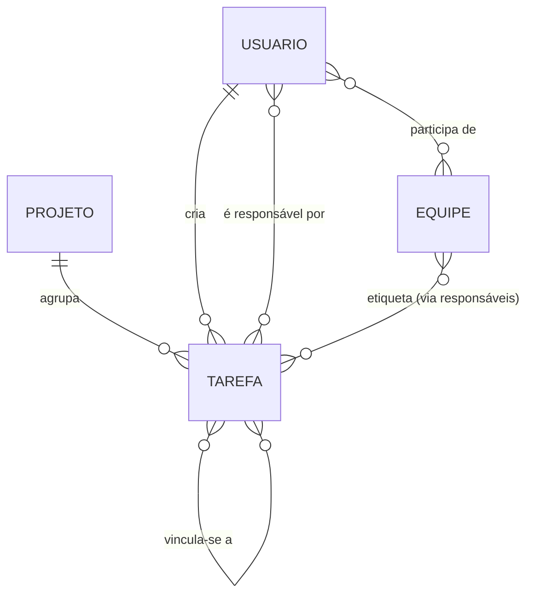

# Domínio do TaskFlow

Este documento descreve o domínio da aplicação: as entidades, os relacionamentos e as regras de negócio. Ele é a referência para as decisões de implementação da API e do frontend.

> **Status:** em construção. As regras marcadas como **(futuro)** estão previstas, mas ainda não implementadas.

---

## Visão geral

O TaskFlow é um gerenciador de tarefas para equipes, inspirado no Jira, que também atende a um fluxo de **helpdesk**: além de tarefas de projeto, ele registra chamados pontuais e as soluções aplicadas, formando uma base de conhecimento.

Os dados de produção (tarefas concluídas e pontos) podem ser exportados em JSON para relatórios por equipe e por usuário.

## Glossário

| Termo | Significado |
|---|---|
| **Tarefa** | Qualquer item de trabalho registrado no sistema. Pode ser de três tipos: tarefa, bug ou chamado. |
| **Chamado** | Tarefa do tipo suporte: uma demanda pontual que, ao ser concluída, registra a solução aplicada. |
| **Projeto** | Tema ou assunto que agrupa tarefas relacionadas. |
| **Equipe** | Grupo de usuários. Funciona como uma etiqueta da tarefa, definida pelos responsáveis. |
| **Responsável** | Usuário encarregado de executar a tarefa. |
| **Pontos** | Medida opcional do tamanho ou do valor de uma tarefa, usada para somar a produção. |
| **Solução** | Registro textual de como uma tarefa foi resolvida. |

## Entidades

### Usuário **(futuro)**

| Campo | Tipo | Regras |
|---|---|---|
| `id` | identificador | Gerado pelo sistema |
| `nome` | texto | Obrigatório |
| `email` | texto | Obrigatório e único |
| `senha` | texto | Obrigatória; armazenada apenas como *hash* |
| `equipes` | lista de ids de equipes | Um usuário pode participar de várias equipes |
| `criadoEm`, `atualizadoEm` | data e hora | Gerados pelo sistema |

### Equipe **(futuro)**

| Campo | Tipo | Regras |
|---|---|---|
| `id` | identificador | Gerado pelo sistema |
| `nome` | texto | Obrigatório e único |
| `criadoEm`, `atualizadoEm` | data e hora | Gerados pelo sistema |

### Projeto **(futuro)**

| Campo | Tipo | Regras |
|---|---|---|
| `id` | identificador | Gerado pelo sistema |
| `nome` | texto | Obrigatório |
| `descricao` | texto | Opcional |
| `criadoEm`, `atualizadoEm` | data e hora | Gerados pelo sistema |

### Tarefa

| Campo | Tipo | Regras |
|---|---|---|
| `id` | identificador | Gerado pelo sistema |
| `codigo` | texto | Gerado pelo sistema, sequencial e legível (ex.: `TF-42`) |
| `tipo` | texto | `tarefa`, `bug` ou `chamado`; padrão: `tarefa` |
| `titulo` | texto | Obrigatório, até 120 caracteres |
| `descricao` | texto | Opcional |
| `projeto` | id de projeto | Obrigatório **(futuro: por enquanto é um texto opcional, até a entidade Projeto existir)** |
| `status` | texto | `a-fazer`, `em-andamento`, `em-revisao` ou `concluida`; padrão: `a-fazer` |
| `prioridade` | texto | `baixa`, `media`, `alta` ou `critica`; padrão: `media` |
| `criadoPor` | id de usuário | Obrigatório; preenchido com o usuário autenticado **(futuro: depende da autenticação)** |
| `responsaveis` | lista de ids de usuários | Opcional |
| `equipes` | lista de ids de equipes | Calculado a partir dos responsáveis; não é informado diretamente **(futuro: depende de usuários e equipes)** |
| `dataInicio` | data (`AAAA-MM-DD`) | Opcional |
| `dataEntrega` | data (`AAAA-MM-DD`) | Obrigatória; padrão: 30 dias após a criação |
| `pontos` | número | Opcional; maior ou igual a zero, com até duas casas decimais |
| `vinculadas` | lista de ids de tarefas | Opcional |
| `solucao` | texto | Obrigatória ao concluir um chamado; opcional nos demais tipos |
| `concluidaEm` | data e hora | Preenchido pelo sistema ao concluir |
| `criadoEm`, `atualizadoEm` | data e hora | Gerados pelo sistema |

## Relacionamentos

## Regras de negócio

### Criação

- **RN01** — Para criar uma tarefa, bastam o título e o projeto. Todos os demais campos têm valor padrão ou são opcionais. **(futuro: o projeto passa a ser exigido quando a entidade Projeto existir; por enquanto, basta o título)**
- **RN02** — O campo `criadoPor` é preenchido automaticamente com o usuário autenticado e não pode ser alterado. **(futuro: depende da autenticação)**
- **RN03** — Se a data de entrega não for informada, ela recebe a data de criação acrescida de 30 dias.
- **RN04** — O código da tarefa é sequencial e nunca é reutilizado, mesmo após exclusões.

### Datas

- **RN05** — Quando as duas datas forem informadas, a data de entrega não pode ser anterior à data de início.
- **RN06** — Uma tarefa não concluída cuja data de entrega já passou é considerada **atrasada**. Esse estado é calculado, e não armazenado. **(futuro)**

### Responsáveis e equipes

- **RN07** — Todo responsável precisa participar de pelo menos uma equipe. **(futuro: depende de usuários e equipes)**
- **RN08** — As equipes da tarefa são calculadas a partir das equipes dos responsáveis, sempre que os responsáveis forem alterados. **(futuro: depende de usuários e equipes)**
- **RN09** — As equipes registradas na tarefa são preservadas mesmo que um responsável mude de equipe depois. Isso mantém os relatórios históricos corretos. **(futuro: depende de usuários e equipes)**

### Vínculos

- **RN10** — Uma tarefa não pode ser vinculada a si mesma.
- **RN11** — Ao excluir uma tarefa, ela é removida da lista de vinculadas das demais.

### Pontos

- **RN12** — Os pontos aceitam no máximo duas casas decimais e não podem ser negativos.
- **RN13** — Para evitar imprecisões de arredondamento nas somas, os pontos são armazenados como um número inteiro em centésimos (ex.: 2,5 pontos são armazenados como `250`) e convertidos na entrada e na saída da API.

### Conclusão

- **RN14** — Um chamado só pode ser concluído com a solução preenchida.
- **RN15** — Ao concluir uma tarefa, o sistema registra a data e a hora em `concluidaEm`. Se ela for reaberta, o campo é apagado.

## Relatórios **(futuro)**

A API vai oferecer rotas de relatório em JSON, com filtros por período:

- **Produção por equipe:** quantidade de tarefas concluídas e soma dos pontos de cada equipe.
- **Produção por usuário:** quantidade de tarefas concluídas e soma dos pontos de cada responsável.

Os relatórios consideram as tarefas pelo campo `concluidaEm`.

## Ideias para versões futuras

- Comentários nas tarefas.
- Anexos (como imagens da solução), armazenados em um serviço externo, com apenas a referência no banco.
- Histórico de alterações de cada tarefa.
- Exportação dos relatórios em CSV.
